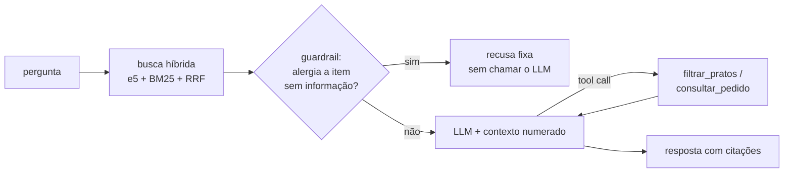

# Assistente de cardápios com RAG, ferramentas e avaliação

Assistente que responde perguntas sobre cardápios e pedidos de uma plataforma de delivery: busca híbrida (embeddings + BM25), citação da fonte, ferramentas para filtros exatos e consulta de pedidos, e um guardrail que **se recusa a afirmar** que um prato é seguro para alérgicos quando o restaurante não informa os alergênicos. Acompanha uma suíte de avaliação com 50 perguntas e 20 consultas de busca difíceis.

[](https://github.com/krosct/project-nov26-p3-rag/actions/workflows/ci.yml)

## Resultados

**Assistente completo** — 50 perguntas ([`data/avaliacao.jsonl`](data/avaliacao.jsonl)): 20 de fato, 10 de filtro, 5 de política, 5 de pedido e **10 armadilhas** que devem ser recusadas (alergênico não informado, item inexistente, fora do domínio).

| Métrica | Automática | Após revisão |
|---|---|---|
| Acerto nas 40 perguntas normais | 100% (juiz LLM) | **97,5%** (39/40) |
| Fidelidade ao contexto (nada inventado) | 100% (juiz LLM) | **97,5%** |
| Armadilhas recusadas | 9/10 | **10/10** |
| Recusas indevidas | 0/40 | **0/40** |
| Latência p50 / p95 | 3,7 s / 18,7 s | |

- **Revisão do juiz:** 20 julgamentos (todos os de filtro e pedido, mais uma amostra) foram conferidos; houve concordância em 19. O caso divergente: em "Quais itens do Verde Raiz não têm castanhas?" o assistente **não chamou a ferramenta**, respondeu só com os 5 trechos recuperados e afirmou algo falso sobre o cardápio inteiro — o juiz aprovou. Lição: o juiz tende a ser otimista e precisa ser auditado.
- A "armadilha que passou" no detector automático era uma recusa correta com redação diferente ("Não encontrei nenhum hambúrguer vegano..."); o detector procura a frase-padrão.
- 6 das 10 armadilhas foram barradas pelo **guardrail em código, em ~0,04 s e sem chamar o LLM**.

**Busca** — 20 consultas difíceis ([`data/busca_dificil.jsonl`](data/busca_dificil.jsonl)): erros de digitação ("xtudo"), sinônimos ("sanduba"), descrição sem o nome do prato ("doce japonês de arroz") e paráfrases de política.

| Busca | Acerto@1 | Acerto@5 | MRR |
|---|---|---|---|
| Lexical (BM25) | 0,55 | 0,80 | 0,62 |
| Densa (`multilingual-e5-small`) | 0,65 | 0,95 | 0,78 |
| **Híbrida (RRF)** | **0,70** | **0,95** | **0,78** |

Nas 31 perguntas do conjunto principal que têm trecho relevante, as três buscas acertam 100% no top-5 (as perguntas citam o nome do prato) — por isso o conjunto de consultas difíceis existe.

## Exemplos (respostas reais da avaliação)

**Quanto custa o Hot Roll de Salmão do Sushi Kento?**
> O Hot Roll de Salmão do Sushi Kento custa **R$ 32,90** [1].

<sub>citação: menu02-item01</sub>

**Quais combos custam até R$ 50?**
> Encontrei 2 combos até R$ 50:
> 
> 1. **Combo Feira** – Pastelaria Ponto Certo – R$ 16,00  
> 2. **Combo Brasa** – Burger Brasa – R$ 49,90  
> 
> (Alérgenos não informados para ambos os itens.)

<sub>ferramenta: `filtrar_pratos`</sub>

**O X-Tudo do Burger Brasa tem glúten?**
> O cardápio do Burger Brasa não informa os alergênicos de "X-Tudo". Por segurança, não consigo confirmar se ele é adequado para sua restrição: confirme os ingredientes diretamente com o restaurante antes de pedir.

<sub>bloqueada pelo guardrail, sem chamar o LLM</sub>

**O Frango Xadrez do Dragão Dourado tem amendoim?**
> Sim, o Frango Xadrez do Dragão Dourado contém amendoim — tanto na descrição ("amendoim") quanto na lista de alérgenos [1].

<sub>citação: menu13-item01</sub>

## Como funciona



- **Chunks** ([`chunks.py`](src/project_nov26_p3_rag/chunks.py)): um por item de cardápio (com restaurante, preço e alergênicos no texto) e um por seção de política — 167 no total. Cortar por tamanho fixo separaria nome e preço do mesmo item.
- **Busca** ([`busca.py`](src/project_nov26_p3_rag/busca.py)): embeddings normalizados numa matriz numpy (busca exata por força bruta: com centenas de vetores, FAISS/pgvector não compensam) + BM25; a fusão por **Reciprocal Rank Fusion** usa só as posições, sem calibrar as escalas diferentes dos dois scores.
- **Ferramentas** ([`ferramentas.py`](src/project_nov26_p3_rag/ferramentas.py)): "pratos até R$ 40 sem glúten" é uma consulta exata, não semântica. O filtro por alergênico **exclui** itens sem informação e diz quantos excluiu.
- **Guardrail** ([`guardrail.py`](src/project_nov26_p3_rag/guardrail.py)): regra em código, testável, em vez de só uma instrução no prompt — em segurança, "funciona quase sempre" não basta.
- **Loop de agente** ([`assistente.py`](src/project_nov26_p3_rag/assistente.py)): escrito à mão (~40 linhas), no máximo 3 voltas de ferramenta.

Corpus: os 20 cardápios do [projeto de extração](https://github.com/krosct/project-nov26-p2-cardapios), 5 políticas fictícias da plataforma e 10 pedidos simulados.

## Como rodar

```bash
uv sync
echo "OPENROUTER_API_KEY=..." > .env
uv run python scripts/ingest.py            # índice: index/chunks.jsonl + embeddings.npy
uv run python scripts/evaluate.py          # avaliação completa → reports/resumo.json
uv run python scripts/avaliar_busca.py     # consultas difíceis → reports/busca_dificil.json
uv run --group app python app.py           # demo local (Gradio)
```

O deploy no Hugging Face Spaces está pronto em [`scripts/deploy_space.py`](scripts/deploy_space.py) (a chave vai como *secret* do Space); hospedar Gradio no Spaces exige plano PRO.

Modelos (gratuitos, via OpenRouter): gerador `nvidia/nemotron-3-ultra-550b-a55b:free`; juiz de **outro fornecedor**, `dots-studio/dots-3-note-preview:free`, para reduzir o viés de autoavaliação. A demo limita 10 perguntas por sessão para proteger a cota da API.

## Decisões e trade-offs

- **Sem LangChain:** o loop de busca → guardrail → LLM → ferramentas tem poucas peças; escrito à mão, cada decisão fica visível e testável (12 testes com LLM e busca falsos).
- **Busca e geração avaliadas separadamente:** quando uma resposta erra, é preciso saber se a falha foi da recuperação ou do gerador.
- **p95, não só a média:** a mediana é 3,7 s, mas perguntas com ferramenta chegam a ~19 s no modelo gratuito.
- **PyTorch só CPU:** mais leve e igual ao ambiente do Spaces gratuito.

## Limitações e próximos passos

- Em 2 das 15 perguntas de filtro/pedido o modelo respondeu sem chamar a ferramenta (uma delas gerou o erro acima). Próximo passo: forçar `tool_choice` quando a intenção de filtro for detectada.
- O juiz LLM aprovou uma resposta errada; vale um conjunto maior de julgamentos revisados para estimar a taxa de falso positivo do juiz.
- Escala (380 mil restaurantes): índice aproximado (pgvector/FAISS), atualização incremental quando o cardápio muda e cache de perguntas frequentes.
- Reranker (cross-encoder) e chunking alternativo ficaram como extras.
